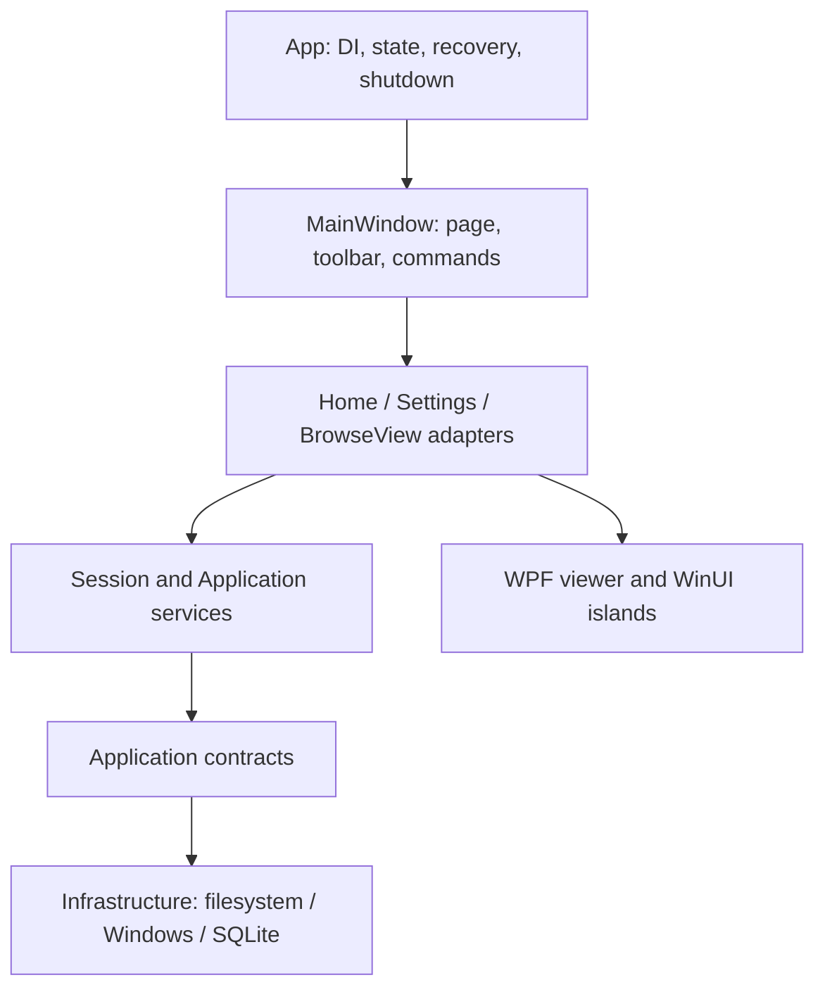

# Architecture

Current implementation and invariants. Product behavior is in [SPECIFICATION.md](SPECIFICATION.md), milestones/evidence in [DEVELOPMENT_PLAN.md](DEVELOPMENT_PLAN.md), active concerns in [PROJECT_STATUS.md](PROJECT_STATUS.md). Read [AGENTS.md](AGENTS.md) before editing.

## Documentation ownership

Keep exactly six authoritative documentation files under `MediFiler3/`; don't recreate phase reports, history archives, documentary JSON/text or a separate test-runner README. Consolidate durable information by purpose and remove superseded notes rather than append contradictory milestone logs.

| Document | Owns |
|---|---|
| AGENTS | Working instructions; preserve user edits |
| SPECIFICATION | Current product requirements and decisions, feature/format/input tables, explicit deferred scope |
| ARCHITECTURE | Current component relationships, implementation/safety mechanics, build/test/fixture and diagnostic guide |
| DEVELOPMENT_PLAN | Major delivered milestones, acceptance/measurement summaries and long-term remaining scope |
| PROJECT_STATUS | Outstanding issues/decisions, verification gaps and immediate next actions; no completed-work diary |
| HANDOVER | Most recent task, local session state and continuation hints; replace freely, don't store enduring policy/history here |

## 1. Stack and project boundaries

Windows desktop, C#/.NET 10, target `net10.0-windows10.0.19041.0`. WPF owns startup/window/composition/navigation; WinUI XAML Islands provide native controls/media. The app is unpackaged/framework-dependent (`WindowsPackageType=None`), with Windows App SDK bootstrap enabled; target machines need Windows App Runtime. Self-contained packaging is not implemented.

| Project | Responsibility / entry points |
|---|---|
| `src/MediFiler3.Domain` | File/folder/operation records, Windows logical filename comparer |
| `src/MediFiler3.Application` | Navigation/session, Gallery selection/drag policy, Reader projection/geometry, viewer coordination/capabilities, file/folder/operation/persistence contracts, settings/root history/layout services |
| `src/MediFiler3.Infrastructure` | Filesystem discovery/listing/counting, Windows image/thumbnail/text/external services, watchers, SQLite/journal/recovery, identity/Recycle Bin/backups |
| `src/MediFiler3.App` | WPF App/MainWindow/views, DI, WPF image/text/GIF adapters, WinUI hosts/media/dialogs/input/airspace/window placement |
| `tests/MediFiler3.Infrastructure.Tests` | xUnit Application business rules and isolated filesystem/storage/cache/recovery tests, despite the name |
| `tests/MediFiler3.App.Integration` | Explicit Windows executable with real dispatcher/WPF/WinUI/native media, restart workers and isolated fixtures; separate from `dotnet test` |

There is no separate WinUI project. Framework-specific controls/pixels/presentations stay in App; contracts use domain records, encoded bytes or bounded decoded data. Keep filesystem work out of UI handlers and format switches out of central navigation.

Current references: Windows App SDK 2.6.4, XamlAnimatedGif 2.3.2, Microsoft.Extensions.Hosting 10.0.0, Microsoft.Data.Sqlite 10.0.14. `global.json` starts at SDK 10.0.0 with latest-major roll-forward/prerelease allowed. Check project files before dependency changes; no bundled codec/FFmpeg runtime.

## 2. Composition and lifecycle

`App.xaml.cs` creates services/host, initializes SQLite/recovery/settings/layout before MainWindow, and applies restored audio preferences before media initialization. Startup is Home without roots/playback. Capture window geometry while dispatcher lives; flush settings/layout/cache/history without waiting on a stopped dispatcher. Keep WinUI available until settings-flush failure notices are handled. Warnings use ContentDialog when WinUI is available, emergency MessageBox only on host failure.



MainWindow validates page/mode/root/folder/current/selection before deferred commands. Native callbacks that navigate are deferred out of native input; don't destroy/mutate their source island synchronously. Commands/dialogs defer reconciliation. Generation/cancellation checks reject stale results but cannot forcibly interrupt blocked OS calls or abandon physical compensation halfway.

## 3. Native boundary, input and geometry

`App/Interop` owns DesktopWindowXamlSource/ContentSiteBridge creation, size/DPI conversion, focus, clipping/stacking and disposal. Home, Settings, sidebar, toolbar, Gallery, Reader, dialogs and media have native hosts. WPF retains the window, tree/carousel, image/GIF/text and fallback surfaces.

- Size native HWNDs in physical pixels from WPF logical bounds/DPI. Keep native WPF caption and Windows 11 DWM colors; WinUI top-level SetTitleBar does not apply to a WPF island host.
- HWND airspace is real: WPF translucency doesn't composite over video/Gallery/Reader. Clip native regions around overlays/reveal edges/fullscreen shell and raise revealed toolbar/sidebar above other islands. Don't revive the rejected popup-tree/transparency workaround.
- Reattachment can reset Gallery's HWND region without changing geometry: reapply exclusions on activation/loading/visibility/arrangement despite cached keys. Test GetWindowRgn/PtInRegion, not only bookkeeping.
- WPF preview and ComponentDispatcher preprocessing feed `MainWindow.TryHandleViewShortcut`. `WinUiViewKeyboard` additionally forwards native PreviewKeyDown from Reader/toolbar/sidebar before controls consume arrows, using native modifier/repeat state. Handled events must not trigger Reader's restoration-cancelling KeyDown observer. Preserve native Gallery modifier navigation, owned-modal/disabled-owner input and native drag ownership of Escape/modifiers.
- Synthetic KeyEventArgs passed to ViewerHost must carry Keyboard.PreviewKeyDownEvent before Handled is set (F4 crash invariant). Deferred shortcuts revalidate context. Reader's dormant-key guard bypasses shared commands without disabling Browse/Gallery mappings.
- `WinUiContentDialogHost` supplies a dedicated full-sized XamlRoot above native content, not the short toolbar root. Escape/close cancel; await ShowAsync before disposal; cancel comparison preview work. `RoundedDialogWindow` clips the outer HWND including children with DPI/size-aware rounded regions and correct GDI ownership. Transparent brushes alone cannot remove black corners.
- `WindowLayoutController`, `WindowLayoutService`, `WindowPlacementPolicy`, `WindowsWindowPlacement` separate dispatcher capture, storage, pure logical geometry and Win32 monitor/workspace/screen conversion. Preserve normal restore bounds and last non-minimized state. Apply normal placement before maximizing; ShowActivated=false background windows maximize at Loaded. Coalesce capture at 100ms, storage at 250ms. Defer work-area changes during gestures; transient fullscreen must never overwrite restart bounds.

## 4. Session, folder loading and Home

`NavigationSessionState` owns roots, active folder, full sorted files/indexed membership, current/position, viewing mode, GallerySelectionState and ReaderSessionState. `FolderTreeEntry.Parent` defines ownership for overlapping roots; don't infer root scope with path prefixes. `NavigationController` owns selection/boundaries. View adapters share context without loading inactive presentation.

`FileSystemFolderTreeService` publishes shallow roots then cancellable breadth-first discovery. Reconcile children in at-most-32 batches with background dispatcher yields. Initial listing is independent. Track discovery completion/count versions so unknown totals stay unknown and stale counts cannot replace operation results. Suppress unchanged DisplayName/count notifications; rescans must not flicker root labels. Exclude reparse/owned-backup paths. Tree virtualization uses recycling/pixel scrolling with two-way model expansion/selection.

`BrowseView.xaml.cs` orchestrates activation, counts, operations and menus. Internal `ActivateFolderAsync` keeps its same-folder no-op. Explicit active-row left-click alone requests forced `ActivateFolderCoreAsync`, cancels older work, clears shared current/selection and commits first-file selection with a validated listing. Reader may defer projection replacement to retain warm pages. Buttons/expanders are excluded.

Operation/watcher reconciliation merges roots/children by path, retains expansion, maps changed subtrees and yields large diffs. Rename/delete/history must not rebuild the whole tree. Shallow collapse changes only direct child expandos. The WPF ellipsis opens a native MenuFlyout positioned through the toolbar island with screen/DPI conversion.

`RootFolderHistoryService` serializes root-only mutations off UI; accepted explicit root publication counts once. Immutable records/Changed notifications feed HomeView orchestration and WinUiHomeIsland cards. Availability is separate from loading history: two probes maximum, three-second caller timeout, permit retained while a blocked OS call finishes. Locate atomically rekeys without merging; Remove only removes saved state. Home versions/cancels availability/open requests, publishes lists before probes, defers navigating native callbacks, restores star focus where possible, and updates relative labels every second without card rebuilds or storage writes.

## 5. Browse handlers and resources

`ViewerCoordinator<T>` and capability-based handlers coordinate generation/cancellation, stale presentation disposal and metadata. App services BitmapViewerHandlers, TextViewerHandler and MediaViewerHandler produce ViewerPresentation variants for ViewerHostView; unsupported types use thumbnail/external recovery. Central interaction policy selects navigation versus content interaction. Format routing lives in SPECIFICATION.

| Adapter | Loading/lifetime |
|---|---|
| Static image | WicImageDecoder uses content services on workers, one decode dimension to preserve aspect, source bounds, frozen WPF pixels and original metadata. Zoom requests source detail; carousel can supply the immediate preview. |
| GIF | GifPresentation/XamlAnimatedGif owns a unique WPF Image and compressed stream after file close. Logical-canvas composition has full-frame caching off; WIC metadata supplies effective one-cycle duration. Dispose on file/view/shutdown. Large logical GIF canvases can exceed static-image memory expectations. |
| Text | FileSystemTextContentService reads bounded Unicode-safe windows; IWindowedViewerHandler supplies content/count scope. Retain same-file window/scroll on return, never execute content. |
| Media | WinUiMediaPlaybackSession adapts MediaPlayerElement/Windows.Media.Playback behind MediaPlaybackController, with cancellable 30s opening, shared audio settings and stale artwork rejection. Release before operations; return/affected content opens paused. Resize/reveal preserves playback session. |
| External | WindowsExternalFileService/association lookup own Windows calls; DefaultApplicationResolver cancels/version-checks results. Association lookup is bounded STA work. Preserve owner/file capture, duplicate suppression and stale completion checks. |

Carousel instances survive adjacent navigation. Coalesce visuals without dropping input; cancel obsolete loads, keep spacer geometry/bounded square fade ghosts and respect animation settings. Fades last 110ms; input/removal never waits on them. Disabled carousel requests no carousel thumbnails. WPF scaling/decoding remains raw/high-quality, not blurred.

## 6. Gallery, drag and thumbnails

### Native Gallery lifetime

WinUiGalleryIsland retains grid/ItemsSource across tabs. Apply the latest coalesced snapshot at Render priority only when host/native grid are visible/loaded. Empty/disjoint replacements publish one Reset on the same source; surviving-path changes stay incremental. Cancel obsolete tiles/hover/selection/reveal before replacement. Routine updates retain decoded survivors.

GallerySelectionState uses case-insensitive paths and natural-order snapshots. `_updating` prevents feedback. Use real GridView-owned automation peers, not duplicate manually constructed peers. Reject old-grid input during deferred diffs. Focus is separate from the selected set. Reveals wait for measured layout independently of SelectedItem and yield to newer input/requests; don't poll or reload equal lists merely to reveal. OutlinedStatus has one live label; outline copies are accessibility-raw.

### Drag

GalleryDragGesture records press scope without capture/handling. Automatic CanDrag/CanDragItems stay false because they intercepted clicks. Start explicit StartDragAsync only after Windows movement thresholds; validate recycled visual identity. Selected origins snapshot the whole natural-order set before native pointer selection changes.

The package carries an opaque per-gesture internal token, not accepted external paths. Capture at most three already realized cropped tiles (192px, 8px offsets, maximum 208px canvas), restore crop during drag, use 80% opacity/hotspot (0,0), native deferrals/version checks/cleanup and default-preview fallback. No offscreen realization/decode for preview.

BrowseView.GalleryDrag* validates gesture/root/folder/revision/files/destination, defers reconciliation and reuses grouped operations. A 50ms timer re-hit-tests layout, expands after 600ms dwell and scrolls 32px edge bands. Scrolling resets dwell/highlight; compare container AND folder identity because tree rows recycle. Leave/drop/cancel/context cleanup stops work.

Native OLE wheel delivery uses temporary WH_MOUSE_LL only during authorized drag, foreground owner and tree hover. Coalesce signed/high-resolution deltas, dispatch outside callback, revalidate exact gesture, honor Windows line/page settings and fallback WPF routing. Every termination unhooks/invalidates packets. Never leave a global hook installed idle or do filesystem work inside it.

### Thumbnail pipeline

FileSystemThumbnailService* returns encoded PNGs. Gallery/carousel use GetDefaultThumbnailPngAsync: normal WinRT StorageFile.GetThumbnailAsync SingleItem without explicit size/options, aspect/orientation/transparency normalization retaining returned dimensions. Display sliders aren't source-size requests. Explicit-size fallback/artwork/collision/tests retain their resize/key contract; don't emulate defaults by passing zero to that API.

| Resource | Bound/rule |
|---|---|
| Encoded memory | 512 entries / 32 MiB LRU, including unavailable results |
| Native Gallery decoded | 512 entries / 128 MiB, actual-dimension byte accounting |
| Work | Three-worker gates at service/native Gallery boundaries, cancellation after permits, per-key coalescing |
| Disk | `%LOCALAPPDATA%\MediFiler3\ThumbnailCache`, existing PNG format |
| Keys | Uppercase normalized full path, length, modified ticks, requested size; private default 0x0 bucket distinct from old explicit hashes |
| Fresh fallback | Known stale images bypass Shell pixels via WinRT source decode, default max 256px without upscaling; Fant downsampling where needed |
| Maintenance | Access writes batch at 30s/shutdown; after 30s idle and at most hourly, expire 90-day-unused entries and prune above 1 GiB toward 900 MiB in yielded 32-entry batches |

Default entries retain creation-time dimensions across DPI changes; no blanket purge/migration. No manual blur on disk or display. Invalidation rejects pre-invalidation/clear in-flight publication. Optional Invalidated/RequiresFreshSource state and zero-byte freshness markers survive restart/housekeeping/explicit image-cache clear. F5 thus measures fresh-source fallback, not normal provider quality; compare normal quality with new/uninvalidated files.

Maintenance verifies owned hash leaf names within resolved non-reparse ancestry. Unknown/link/changed/unsafe files remain. Adopt legacy PNGs conservatively (unknown age starts now); missing source mapping invalidates conservatively. Recognized abandoned temporary writes older than one day may be removed. Locked entries/invalidation remain retryable; indexed usage can undercount unadopted legacy files. Never cache-prune sources, backups, settings or journals.

## 7. Reader pipeline

ReaderSessionState owns projection, path/fraction/gap anchor, dimension ratios/prefix geometry and visible/preload window, never pixels. It projects the shared listing without replacing it. ReaderNavigation provides bounded navigation/query policy; ReaderOptions persists in the existing settings payload.

WinUiReaderIsland uses ScrollViewer/Canvas with explicit row realization, not another native observable source. Realize visible pages plus one previous and configured upcoming pages. FileSystemReaderImageService opens a disposable stream, uses WinRT BitmapDecoder with EXIF/sRGB/premultiplied BGRA and bounded output, then closes inputs. Copy bytes into XAML-owned WriteableBitmap, never a disposable bitmap still needed by deferred rendering.

| Resource/state | Invariant |
|---|---|
| Source jobs | Two concurrent service jobs; native permits also bound scheduling |
| Output/page | Maximum 4,194,304 pixels / 16 MiB BGRA; not a codec-internal/process ceiling |
| Width | DPI-aware 128px buckets, capped at 8192, no source upscaling |
| Native decoded LRU | Maximum 128 MiB; valid width-bucket survivors reusable |
| Geometry | Original aspect; minimum 24px row/placeholder; centered column, no trailing page gap |
| Inactive | Cancel/remove realized rows, reject late results; keep geometry and bounded warm pixels |

ChangeView can finish asynchronously even without animation. Keep `_restore` and intended path/fraction/offset until the actual offset arrives; realize the intended window instead of interpreting stale zero/old offsets. Explicit small-page targets survive non-scrolling input; actual scrolling supersedes them. End follows the tail as dimensions arrive. Delayed actions check interaction version, membership and activity. Retry invalidates only its source; update automation page names after reorder while retaining unaffected rows/images.

BrowseView.Reader adapts current-page publication without starting Browse playback/carousel. ReaderOperations uses existing one-page batch outcomes/journals/collisions/count refresh. Rename/history/folder refresh defer Reader reconciliation until final listings. MapPaths stages mappings, including ratios, atomically with replacement projection; never expose a renamed anchor against old pages while awaiting work. Normal listings stay synchronous for immediate jump/End/retry. Commit preferred-page history state only with a context-validated listing.

ReaderExternal owns lightweight association/launch state independently from inactive ViewerHost. APIs remain while toolbar/shortcut entry points are deliberately hidden. SetReaderControls, SetGalleryControls and UpdateExternalCommandVisibility jointly derive visibility: neither setter may restore external buttons in Gallery/Reader accidentally. Reader-only dormant keys bypass shared command mappings; failed-page recovery remains.

## 8. Operations, journal and backups

IFileOrganizationService.ForRootAsync resolves root filesystem identity off UI and binds IFileOperationJournal.ForRoot(identity). Prepare durable intent before mutation, verify before completed events. Recovery inspects unfinished intents across roots and flags ambiguity instead of automatically retrying uncertain work. Root-scoped candidates/batches/redo invalidation/events/compensations cannot cross scopes. Legacy NULL RootScope records remain inspectable but aren't guessed into active stacks.

Commands snapshot source/clicked-root ownership and context before dialogs. BrowseCollisionResolver dispatches UI and revalidates answers. FileRenameName owns extension-preserving names/suffixes. Collision previews load metadata and bounded 240x160 thumbnails off UI; closing cancels work. Paths/exact bytes are hover information; don't recursively scan folder size.

| Phase | Invariant |
|---|---|
| Collision/overwrite | Reject types/links/unsafe ancestry/volumes. Explicit overwrite revalidates destination identity and journals preservation into same-volume GUID storage before installing incoming data; no destructive overwrite API. |
| Failed install | Journal preservation rollback; retain versions/recovery paths if races make restoration ambiguous. |
| History/compensation | Undo reverse batch order, Redo original order. Compensation stays in root and doesn't branch redo. Once displacement/physical compensation starts, finish verification/rollback despite cancellation. |
| History collision | Preserve blockers; ResolvedPath/DisplacedItem event metadata restores them on opposite replay. IsReplacementBackup/OriginalAttributes identify/hide/restore backup state. Ambiguity marks RecoveryRequired, excluding unsafe retries. |
| Recycle restore | STA Shell namespace adapter requires unique original-path/type/identity match. Verify restored identity; file-only streamed length/SHA-256 fallback may compare selected recycled content when Windows changes identity. Never permanently delete as fallback. |
| Partial batch | Retain per-item outcomes, UnattemptedCount and WasCancelled. Ordinary errors may continue; cancellation/recovery uncertainty stops. Completed items form one root-scoped group. |
| Cleanup | OperationMaintenanceGate serializes cleanup/mutations. Durably HistoryDiscarded the whole dependent root/batch before deleting verified backups. Failed deletion leaves retired data for retry. Never delete restored/current/untracked/changed/link/recovery data. No automatic purge. |

FileSystemOperationBackupStore uses local app UndoBackups when same-volume, otherwise hidden `.MediFiler3-UndoBackups-<user identity hash>` at that volume root. Verify ownership/reparse state; refuse unavailable safe storage. New replacements don't use sibling backups; legacy paths stay usable/explicitly cleanable without relocation.

Release native media before file/folder mutations/history and reopen affected/cancelled current media paused. Merge tree/count updates, not full resets. Undo chooses restored files; Redo removing current chooses next/prior-at-end, using Reader's image projection when applicable. Refresh history availability even when root node identity is retained.

## 9. Watcher reconciliation

FileSystemFolderChangeMonitor covers all loaded roots, including inactive ones, only in Browse/Gallery/Reader, reducing duplicate/nested coverage. Stop on Home/Settings, replacement/shutdown; retain healthy coverage when paths stay equal.

FolderChangeBuffer: 500ms quiet debounce, 2s maximum delay, 1,024 distinct paths, overflow/error rescan. One awaited dispatcher consumer prevents unbounded queues. Commands/loading/dialogs/external opens defer application; revisions reject stale work. Health probes have two permits, five-second healthy checks and failure backoff 1-60s. Degraded coverage polls active folder, then rescans on reconnect. Blocked OS calls retain permits until completion.

Healthy startup/return reconciles metadata without flushing unchanged pixels. Content hints/F5/overflow/failed-coverage recovery stay authoritative, including equal-size/timestamp edits. Edits without delivered hints while coverage stopped can need F5. Retain selected path/nearest position, safe missing-folder fallback, tree expansion and unrelated playback/zoom/text/anchors. Affected media reopens paused; automatic work never increments root visits.

BrowseView.OperationReconciliation tracks verified same-volume structural move echoes for at most 512 paths/30 seconds after identity/size/timestamp or absence checks. Warm source previews may survive these echoes. Unknown/new/overwrite destinations, changed versions, expiry/F5/overflow/recovery/content hints use normal invalidation. Strong hints retire echo tracking and dominate structural hints for the same path.

## 10. Persistence

Database: `%LOCALAPPDATA%\MediFiler3\medi-filer.db`. SqliteDatabase uses schema **7**, WAL/FULL durability, transactional supported 1-6 upgrades and rejects newer schemas. Don't downgrade/replace a user's database to run older code.

| Data | Storage/ownership |
|---|---|
| Intent/events | FileOperations/FileOperationEvents: preparation/completion/recovery/compensation |
| Root scope | Schema 5 nullable RootScope/index; legacy unscoped records preserved, never inferred |
| Replacement compatibility | Schema 6 guards against older builds misinterpreting replacement/history semantics |
| Typed state | Schema 7 retains ApplicationSettings, WindowLayout, RootFolderHistory, ThumbnailCacheIndex; independent JSON payload versions currently v1 |
| Keys | Settings/layout singleton; normalized case-insensitive absolute roots; existing thumbnail keys |

Optional Reader/options, monitor metadata and cache freshness/source fields extend payloads without schema bumps. Validate writes; corrupt/unknown data reports/logs errors and falls back without automatic destructive overwrite. Real changes may replace fallback state. Loading history doesn't probe/reopen roots.

Settings/layout debounce at 250ms and serialize saves; root-history mutations serialize independently; cache access batches at 30s. Playback progress never schedules settings writes. Capture latest state while UI lives; flush started writes at shutdown without dispatcher dependency.

## 11. Build and verification

Run from repository root on Windows/PowerShell with .NET SDK/Windows App Runtime. Use the same temporary BaseOutputPath for build and no-build runners to avoid replacing a running user binary. Never build concurrently against shared obj directories; don't automatically restart the app, commit, push or deploy.

```powershell
dotnet build MediFiler3.sln --verbosity minimal "-p:BaseOutputPath=$env:TEMP\MediFiler3ContinuationBuild\"
dotnet test tests/MediFiler3.Infrastructure.Tests --no-build --no-restore --verbosity minimal "-p:BaseOutputPath=$env:TEMP\MediFiler3ContinuationBuild\"
dotnet run --project tests/MediFiler3.App.Integration --no-build --no-restore "-p:BaseOutputPath=$env:TEMP\MediFiler3ContinuationBuild\" -- "$env:TEMP\MediFiler3Phase3Fixtures"
git diff --check
```

After restore, build may use `--no-restore`. Unit/native runners can run independently after build; native timing samples should run sequentially. Focused alternatives replace the fixture directory with `--reader-only`, `--gallery-only` (UI refinement/Gallery) or `--gallery-resume-only`; generated focused runs don't replace full codec acceptance. Internal `--phase4-restart-worker` isn't a production option; full runs launch seed/reopen/verify workers automatically.

The native runner uses real dispatcher/WPF/WinUI in transparent non-taskbar windows, muted media and stubbed/recorded external launches. Supplied media is copied before mutations; real file/Recycle Bin/backup operations use isolated fixtures. Artifacts remain in `%TEMP%\MediFiler3Integration-<guid>`. This executable is built with the solution but run separately from `dotnet test`. Failures yield exit 1; missing fixtures are skips. Complete format acceptance requires zero skips, not only exit zero.

Generated fixtures cover WPF images/GIF89a, text/extensions, six encodings, large text, silent PCM WAV and corrupt/unknown files. Supply valid `.webp`, `.mp4`, `.m4v`, `.wmv`, `.webm`, `.mkv`, `.mp3`, `.wma`, `.m4a`, `.aac`, `.opus`; optional `.wav` replaces generated WAV. Historical local directory: `%TEMP%\MediFiler3Phase3Fixtures`, not a guaranteed repository resource. Representative origins: Google WebP sample (`https://www.gstatic.com/webp/gallery/1.webp`), W3C Sintel MP4/WebM and official Opus sample; Windows MediaTranscoder produced short MP3/WMA/M4A/ADTS-AAC/WMV. M4V is MP4 alias; MKV is WebM/Matroska subset. Don't rename unrelated content to claim codec coverage or silently install codecs.

| Area | Files in `tests/MediFiler3.App.Integration` |
|---|---|
| Formats/interactions/playback/resources | Program.cs, GifChecks.cs, thumbnail/handler checks |
| State/restart/operations | Phase4RestartChecks.cs, RootHistoryChecks.cs, ContentDialogChecks.cs, WatcherChecks.cs |
| Gallery/selection/drag | GalleryChecks.cs, GalleryInputChecks.cs, GalleryResumeChecks.cs, GalleryMutationChecks.cs, GalleryDragChecks.cs, ThumbnailRenderingChecks.cs |
| Reader/current folder/visibility | ReaderChecks.cs, ReaderMutationChecks.cs, FolderClickChecks.cs |
| Actual-file characterization | ReaderAcceptanceChecks.cs writes reader-acceptance.json for 1,000 generated PNGs |
| Tree/fullscreen/layout | UiRefinementChecks.cs, WindowLayoutChecks.cs |

Restart workers use real SQLite/services/window state across three processes: seed settings/history/backups/cache/layout; reopen and verify scoped replay/watcher/cache isolation; verify fresh Home startup and retained cleanup/history. Not an installer/App-host failure-path test. Native probes must wait for loaded/realized/settled controls and actual offsets: a warm bitmap alone doesn't mean new layout settled. Retain pixel/fraction assertions and diagnostics rather than weaken tests for timing failures. Direct router/automation-peer calls don't establish physical input/Narrator/DPI acceptance; HWND key-message coverage is stronger but still not a whole matrix.

## 12. Failure knowledge to preserve

| Failure | Evidence/fix/invariant |
|---|---|
| Reader native image-worker crash | 2026-11-11 Event 1000 Microsoft.UI.Xaml.dll 3.3.0.0 / 0xc000027b, offset 0x3d1699; WER RO_E_CLOSED (0x80000013). Three stacks resolved AsyncCopyToSurfaceTask::CopyOperation/Execute. SoftwareBitmapSource.SetBitmapAsync returned before deferred render finished using disposed input. Keep XAML-owned WriteableBitmap copies; no global exception suppression. |
| Browse F4/zoom/media crash | Event 1026 (2026-11-12): `Every RoutedEventArgs must have a non-null RoutedEvent associated with it.` ViewerHost.HandleKey -> BrowseView.HandleViewShortcut -> MainWindow.TryHandleViewShortcut/OnFullscreenMessage; synthetic args lacked RoutedEvent before setting Handled. Event 1000 KERNELBASE.dll / 0xe0434352, WER d4b957cd-5365-4649-b29e-e357d504b73c. Assign event before forwarding. |
| Gallery collection faults | Intermittent 0xC0000005 in WinRT collection notifications; peer attribution inconclusive, layout deferral alone didn't eliminate recurrence. Retained sources/atomic disjoint Reset/deferred loaded diffs/real peers are safeguards, not universal elimination. Record shared-path versus disjoint versus transition context. |
| Later native transition fault | Microsoft.UI.Xaml.dll / 0xc000027b after native F11/history transition, WER a6f5529d-57b1-4dc6-ad96-77d08cc3b42a; old `%TEMP%\MediFiler3TreeFeedback-WER.txt` / `MediFiler3TreeFeedback.log`. Deferred native dispatch addresses a lifetime risk; root cause unproven. |
| Physical Reader arrows missing | Router-only tests missed native delivery. PreviewKeyDown bridge and ignoring handled KeyDown avoid control consumption/restoration cancellation. Keep HWND SendMessage/PostMessage/repeat/cross-focus tests. User confirms arrows work. |

Reader dumps were retained outside repo under `%LOCALAPPDATA%\CrashDumps`: MediFiler3.App.exe.61292.dmp, .57884.dmp and .56752.dmp. Matching public PDB RSDS C1689B46-4BD2-CADF-9955-9893CD94970C, age 2: FailFastWithStowedExceptions+0x61 at +0x3d1699, CopyOperation cold +0x36ab02, Execute+0x92 at +0x1e4462. Analysis scanned captured stack addresses with dbghelp/matching symbols, not a complete unwind; nested stowed-exception heap records were absent. Temp symbols/scripts/logs aren't guaranteed to survive. Capture new WER/dumps/context on recurrence. Current outstanding concerns belong in PROJECT_STATUS, not repeated historical pass counts here.
